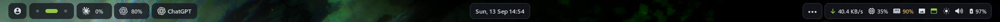

# YASB

YASB reads this folder directly through `YASB_CONFIG_HOME`. Edit here; no copies or symlinks are needed. Config and style changes reload automatically.

## Controls

- CPU, memory, network, usage, clock, brightness and volume: left click opens details.
- Volume: scroll adjusts; middle click mutes; right click cycles outputs.
- Brightness: scroll adjusts; middle click opens the right-pill editor.
- Wallpaper: left click opens the native gallery; middle click opens themes; right click selects the next image. Wallpaper changes apply to all desktops.
- Taskbar: left click toggles; middle click shows; right click hides.

## Customization

The right-pill editor saves `right-pill.json` and `right-pill.css`. Width `0` is automatic; an empty glyph keeps native state icons. Preview tests the live bar; Apply saves; Revert restores the saved style. Closing cancels an unapplied preview.

Theme settings live in `theme-settings.json`; generated colors live in `palette.css`. Edit through the theme panel. The accent follows the wallpaper. `yasb_colors.css` and logs are generated, not source files.

## Requirements

YASB 2.0.7, PowerShell 7, thide, Nerd Fonts and Segoe Fluent Icons. Usage widgets require their matching account logins. Keep the licenses and signed files in `vendor/VirtualDesktop` unchanged.
